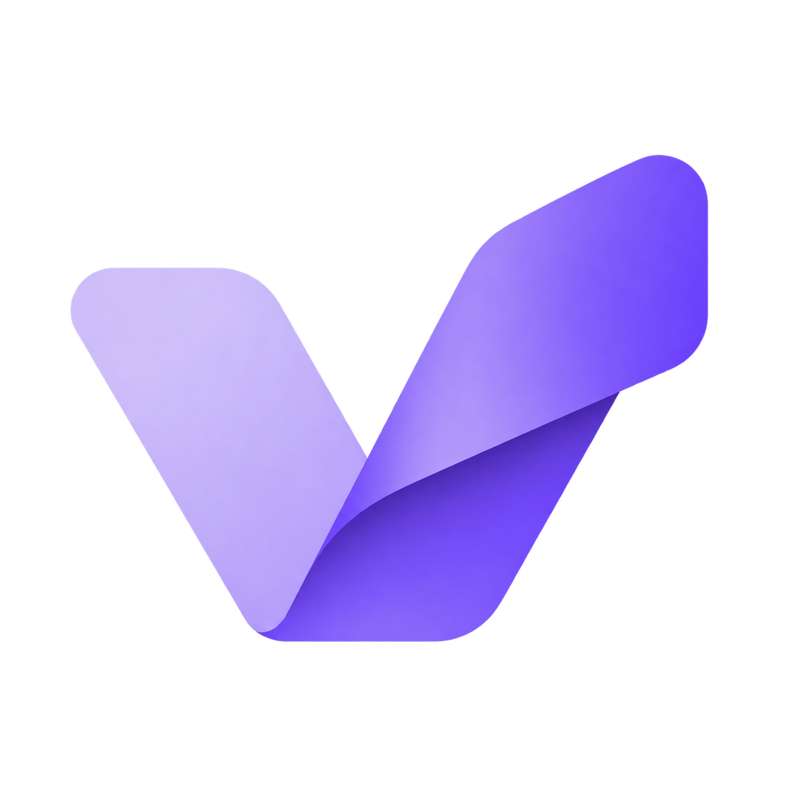
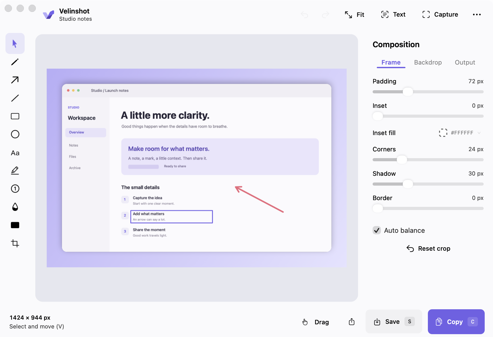
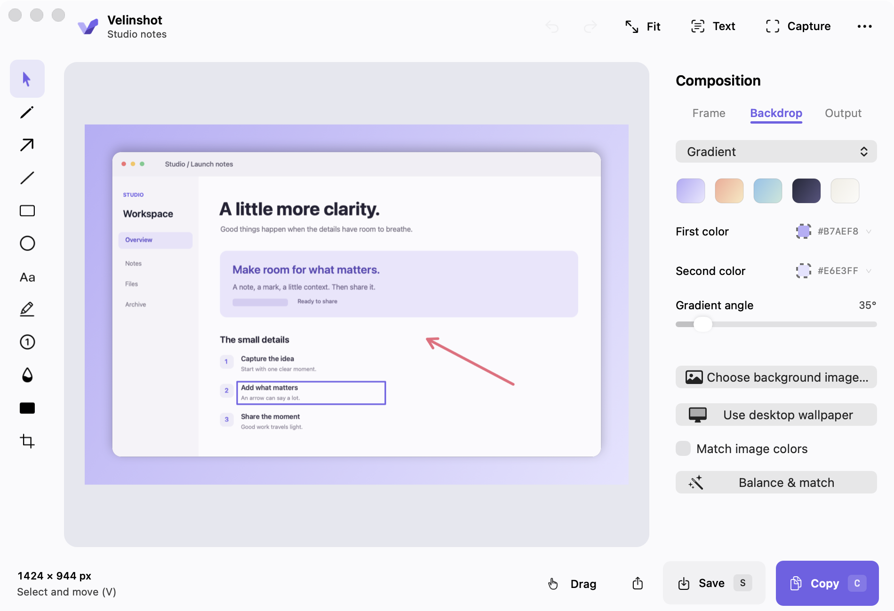
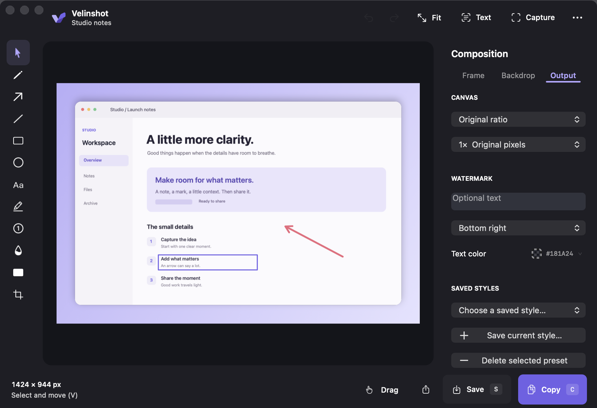
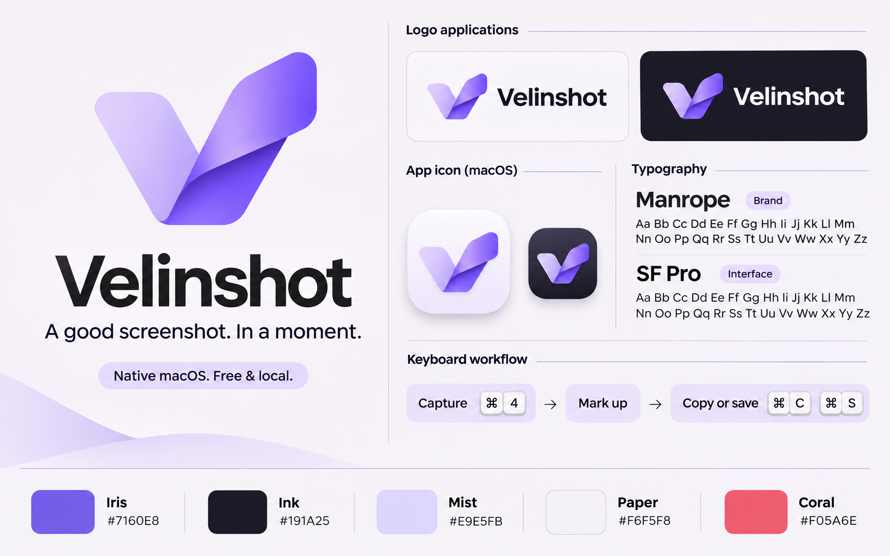

<div align="center">
  
  <h1>Velinshot</h1>
  <p><strong>A good screenshot. In a moment.</strong></p>
  <p>Capture, frame, mark it up. Copy and carry on.</p>
  <p>
    <a href="LICENSE"></a>
    
    
    <a href="https://github.com/Jacknelson6/Velinshot/actions/workflows/ci.yml"></a>
  </p>
  <p><a href="https://github.com/Jacknelson6/Velinshot/releases">Download</a> · <a href="#make-it-yours">Build it</a> · <a href="docs/FEATURES.md">Features</a> · <a href="brand/BRAND.md">Brand kit</a></p>
</div>

<picture>
  <source media="(prefers-color-scheme: dark)" srcset="brand/editor-dark.png">
  
</picture>

<sub>Native UI rendered from the real app with a synthetic fixture.</sub>

Free, native screenshot editing for macOS. No account, subscription, watermark requirement or browser runtime. Built from scratch with Swift and the frameworks already on your Mac.

## One short flow

**⌘4 → capture → edit → C to copy, or S to choose where to save.**

Drag an area, press Space to capture a window, or capture a whole display. The screenshot opens straight into a compact editor. Add an arrow, draw a box, soften the corners, give it some breathing room, and send it on its way.

| Capture | Mark it up | Make it look right | Get it out |
|---|---|---|---|
| Area, window, display | Pen, arrow, line | Separate padding and inner inset | One-key copy and save |
| File and clipboard import | Rectangle, ellipse | Rounded corners, shadows, borders | PNG and compressed JPEG |
| Drag an image into the editor | Text and numbered steps | Gradient, color, image, desktop wallpaper | Drag a finished PNG to another app |
| Editable local history, opt-in | Highlight, blur, opaque redact | Exact pixel sizes and social canvases | Native Share picker |
| Reopen the last closed capture | Move, resize, recolor, undo | Saved presets and optional text watermark | Copy or save the original image |

Local OCR lets you select and copy the words in your image. Automatic PII detection is intentionally excluded. Manual redaction stays available.

| Backdrop | Output |
|---|---|
|  |  |

<sub>Real native views, shown with the same synthetic screenshot.</sub>

## Make it yours

Requires macOS 14 or later. The packaged build targets Apple Silicon; the source can be built on a compatible Mac with Apple's Swift toolchain.

```sh
git clone https://github.com/Jacknelson6/Velinshot.git
cd Velinshot
bash scripts/build-app.sh
open build/Velinshot.app
```

The build script makes an app bundle with a local ad-hoc signature. A Developer ID and Apple notarization are not included. Downloaded builds may require macOS's normal approval to open; building locally avoids depending on a distribution signing service.

On first capture, allow **Velinshot** in **System Settings → Privacy & Security → Screen & System Audio Recording**. The Settings window has a shortcut to that pane. macOS may require a relaunch, and a newly rebuilt ad-hoc app may need consent again.

**Already running Xnapper?** Velinshot protects its known default shortcuts. Quit Xnapper to use ⌘4, or record another shortcut in Velinshot Settings. ⌘⇧2 is offered as an alternative. No incumbent settings are changed.

## Your hands can stay on the keyboard

| Key | Action |
|---|---|
| ⌘4 | Capture and edit, configurable |
| ⌃⌥⌘5 | Capture and copy, configurable |
| C / ⌘C | Copy finished image; optionally close |
| S / ⌘S | Native save picker |
| ⌘Z / ⇧⌘Z | Undo / redo |
| D · A · R · E | Draw · Arrow · Rectangle · Ellipse |
| T · H · B · K | Text · Highlight · Blur · Redact |
| N · X · L · V | Number · Crop · Line · Select |
| Delete | Remove a selected mark |
| ⌘0 · ⌘+ · ⌘− | Fit · Zoom in · Zoom out |
| ⌘1 · ⌘2 · ⌘3 | Frame · Backdrop · Output inspector |
| ⇧⌘T | Reopen the last closed screenshot |

Shift constrains boxes to squares, ellipses to circles, and arrows/lines to 45-degree directions. Double-click a text mark to edit it, or double-click the background to copy and close. Letter shortcuts yield while you are typing.

## Small by design

The app uses **AppKit, Core Graphics, ScreenCaptureKit, ImageIO and Vision**. There are no Swift package dependencies, embedded Chromium, Electron, Tauri, Rust runtime or background web service. Shared layout and drawing code keep rounding, crops and annotations aligned. File decoding and exact balance analysis run on one serial worker. A cached display proxy makes editing cheaper; copies, saves, OCR and history use the retained original pixels.

Images are limited to 40 megapixels and 16,384 pixels per side. Previews render at a reduced raster size. Local history is off by default and capped at 50 entries or 250 MB when enabled. The most recently closed image is retained in memory until replaced or the app quits. There is no polling service or recurring idle render. See [performance notes](docs/PERFORMANCE.md) for measured scope and limits.

## Local work stays local

Capturing, rendering, OCR and history work on your Mac. No screenshot is uploaded, and there are no analytics or account requests. A manual **Check for Updates** command asks GitHub for public release metadata. Sharing happens only through the destination you choose in macOS's Share picker.

History and presets live in Application Support by default. A custom history location uses a dedicated `Velinshot History` subfolder. Custom backgrounds are copied into a managed local asset store so presets can reopen them.

## Built to be checked

```sh
bash scripts/check.sh
```

Full Xcode runs the XCTest suite. Command Line Tools installations without XCTest run the same scenario bodies through an explicitly named native assertion harness. Unsupported test constructs fail rather than being skipped. Local checks also exercise hidden native canvas gestures, preferences, promised PNG files, real image decoding and OCR.

Hosted CI runs XCTest, a release build and bundle validation. Screen Recording and real drag/Share flows require a Mac GUI and are reported separately. See [validation notes](docs/QA.md) for evidence and remaining permission-dependent checks.

## The identity



The folded V is an original generated identity, selected from twelve concepts across four directions. [The brand kit](brand/BRAND.md) includes the transparent mark, app icon, light/dark wordmarks, palette, type, image board and generation prompts.

Contributions are welcome. [Read the guide](CONTRIBUTING.md), keep the app small, and make the screenshot better.

[MIT licensed](LICENSE). Manrope is distributed separately under the SIL Open Font License in `brand/fonts`.
