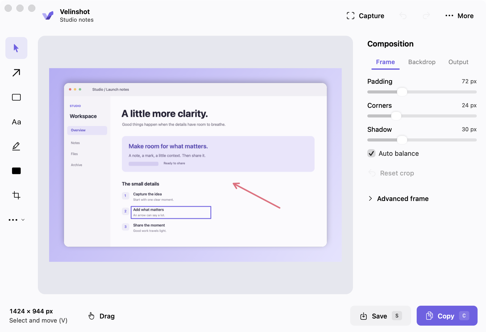

<div align="center">
  <h1>Velinshot</h1>
  <p>Free, native screenshot editing for macOS.</p>
  <p>
    <a href="https://github.com/Jacknelson6/Velinshot/actions/workflows/ci.yml"></a>
    
    <a href="LICENSE"></a>
  </p>
  <p><a href="https://github.com/Jacknelson6/Velinshot/releases/tag/v1.0.0-preview.1"><strong>Download preview</strong></a> · <a href="#build-from-source">Build from source</a> · <a href="docs/USAGE.md">User guide</a></p>
</div>

<picture>
  <source media="(prefers-color-scheme: dark)" srcset="docs/images/editor-dark.png">
  
</picture>

<sub>Real AppKit views rendered with a synthetic screenshot.</sub>

**⌘4 → capture → edit → C to copy or S to save.**

Capture opens a compact editor. Draw an arrow, adjust the frame, then copy the result or choose where to save it. Shortcuts are configurable.

- **Capture:** area, window and display, plus file, clipboard and drag import.
- **Annotate:** arrows, boxes, pen, text, numbered steps, highlight and manual redaction. Draw across the entire canvas, including the mat outside your screenshot.
- **Frame:** automatic inset color, padding, rounded corners, shadows, backgrounds, exact sizes and saved presets.
- **Export:** PNG or JPEG, one-key copy/save, drag export and the native Share picker.
- **Keep working:** local OCR, undo/redo, reopen the last screenshot and optional editable history.

## Download and open

[Download the Apple Silicon preview](https://github.com/Jacknelson6/Velinshot/releases/download/v1.0.0-preview.1/Velinshot-preview-arm64.zip). Requires **macOS 14 or later**. Unzip it and put **Velinshot.app** in your chosen location before granting capture access.

The preview is ad-hoc signed and **not notarized** by Apple. If macOS says it could not verify Velinshot:

1. Click **Done** in the blocked-opening alert.
2. Go to **System Settings → Privacy & Security** and scroll to **Security**.
3. Click **Open Anyway** beside Velinshot, then confirm the opening prompt. Authenticate if macOS asks.

See [Apple's first-launch instructions](https://support.apple.com/en-us/102445).

For capture, enable **Velinshot** under **Privacy & Security → Screen & System Audio Recording**, then relaunch if requested. The [user guide](docs/USAGE.md#capture-access) explains permission and shortcut troubleshooting.

**Preview status:** native editing and real display capture have been verified. Some capture and cross-app delivery checks remain open. [Validation and known limits](docs/QA.md).

## Small and local

About **2.2 MB**, built with Swift, AppKit and system frameworks. No external package dependencies or embedded browser. Image preparation runs on a serial worker, and editing reuses a reduced display proxy while exports retain the original pixels. [Measured performance](docs/PERFORMANCE.md).

No account, subscription, analytics or required watermark. Screenshots stay on your Mac unless you share them. History is off by default. The manual update command checks public GitHub release metadata. Automatic PII detection is excluded; manual blur and redaction are available.

## Build from source

Requires macOS 14 or later and Apple's Swift toolchain. The [package manifest](Package.swift) declares Swift 5.9 tools or later.

```sh
git clone https://github.com/Jacknelson6/Velinshot.git
cd Velinshot
bash scripts/build-app.sh
open build/Velinshot.app
```

The script creates a locally ad-hoc signed app. Run checks with `bash scripts/check.sh`. Full Xcode runs XCTest; Command Line Tools use the documented native assertion fallback. [Contributing](CONTRIBUTING.md).

## Documentation

| Use the app | Work on the app |
|---|---|
| [User guide and shortcuts](docs/USAGE.md) | [Contributing](CONTRIBUTING.md) |
| [Feature reference](docs/FEATURES.md) | [Product scope](PRODUCT.md) |
| [Preview validation](docs/QA.md) | [Interface design](DESIGN.md) |
| [Report a bug](https://github.com/Jacknelson6/Velinshot/issues/new/choose) | [Performance evidence](docs/PERFORMANCE.md) |

[MIT licensed](LICENSE).
