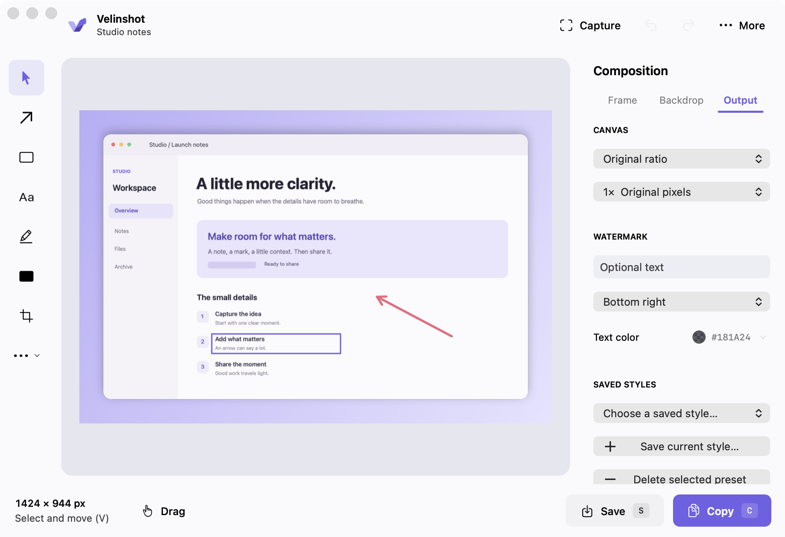

# User guide

## Capture and import

Press **⌘4** to capture and edit. Drag an area, use **Space** for window selection, or choose display capture from the File menu. **Escape** cancels. Set a different global shortcut in Settings if needed.

Open an existing image through the File menu or toolbar, paste an image from the clipboard, or drop an image into the editor. The editor opens after capture or import.

## Frame and annotate

Use **Frame**, **Backdrop** and **Output** to adjust geometry, backgrounds and export size. Outer padding and inner inset are separate. Inset fill follows the visible image's dominant edge color by default. Choosing a color turns Auto off; use Auto to restore matching. Older saved presets and history retain their recorded colors.

| Backdrop | Output |
|---|---|
|  |  |

Draw anywhere in the framed canvas, including the mat around the screenshot. Crop and blur stay within the image. Shift constrains boxes to squares, ellipses to circles, and arrows/lines to 45-degree directions. Use Select to move, resize or recolor marks. Double-click text to edit it. Tab cycles through marks, including marks hidden after a canvas resize.

Double-click empty background in Select to copy and close. Text editing owns letter shortcuts while you type. The outer canvas is the export boundary.

## Copy, save and share

**C** copies the finished image and closes the editor when that preference is enabled. **S** opens the native save picker so you can choose the destination, PNG/JPEG format and JPEG quality. The File menu also offers the original, unframed image.

Drag export advertises a promised PNG file and PNG pasteboard data. Share opens the native macOS destination picker. Final Finder receipt and Share destination delivery remain [manual preview checks](QA.md#remaining-manual-checks).

## Shortcuts

| Key | Action |
|---|---|
| ⌘4 | Capture and edit, configurable |
| ⌃⌥⌘5 | Capture and copy, configurable |
| C / ⌘C | Copy; optionally close |
| S / ⌘S | Choose where to save |
| ⌘Z / ⇧⌘Z | Undo / redo |
| D · A · R · E | Draw · Arrow · Rectangle · Ellipse |
| T · H · B · K | Text · Highlight · Blur · Redact |
| N · X · L · V | Number · Crop · Line · Select |
| Delete | Remove selected mark |
| Tab / Shift-Tab in Select | Cycle through marks |
| Escape | Cancel capture or release canvas focus |
| ⌘0 · ⌘+ · ⌘− | Fit · Zoom in · Zoom out |
| ⌘1 · ⌘2 · ⌘3 | Frame · Backdrop · Output |
| ⇧⌘T | Reopen the last closed screenshot |

## Capture access

Allow Velinshot in **System Settings → Privacy & Security → Screen & System Audio Recording**. Settings has a shortcut to that pane. Relaunch if macOS asks. First-launch Gatekeeper approval is a [separate step](../README.md#download-and-open).

If access appears enabled but capture fails after replacing a locally built app, the permission may belong to an older signature. Use **Show This App in Finder** in Settings to identify the current copy, then refresh that app's Screen Recording entry. A rebuilt ad-hoc app can require consent again.

If a shortcut is unavailable, use **Retry shortcuts** or record another combination. Availability comes from macOS registration, rather than whether another screenshot app is running.

## Local files and limits

History is off by default. When enabled, it keeps at most **50 entries or 250 MB** in Application Support, or a dedicated `Velinshot History` subfolder at your chosen location. Presets and imported background assets are stored locally. The most recently closed screenshot stays in memory until replaced or the app quits.

Image input is limited to **40 megapixels**, **16,384 pixels per side** and **250 MB encoded input**. Fixed-size exports fit the source uniformly and fill extra space with the selected background. Watermark text can be rejected if the chosen output is too small; clear it or use a larger canvas. Dynamic or inaccessible wallpapers fall back to the current gradient.
