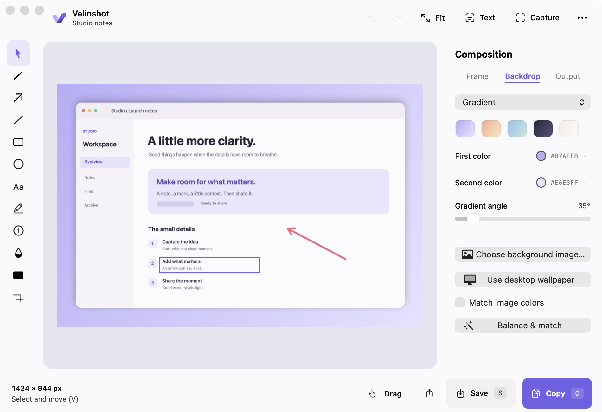

# User guide

## Install and open

Velinshot is free and open source. The Mac preview requires **Apple Silicon and macOS 14 or later**. [Download it here](../README.md#download-and-open).

Allowing the app to open and allowing it to capture your screen are **two separate approvals**. Complete both below.

### 1. Install in Applications

1. If Velinshot is already running, save or copy your open screenshots, then choose **Velinshot → Quit Velinshot**. Closing its window alone can leave it running in the menu bar.
2. Open the downloaded `.dmg` file and drag **Velinshot.app** onto **Applications**. If replacing an older copy, confirm **Replace** after quitting it.
3. Eject the disk image. In Finder, open **Applications**, then double-click **Velinshot**. Use this installed copy each time.

For a ZIP download, unzip it and move **Velinshot.app** into **Applications** before opening it.

### 2. Use Open Anyway if macOS blocks the app

This free preview is **not notarized by Apple**. A message that Apple cannot verify Velinshot is expected for this release.

1. Try opening **Velinshot** from **Applications** first. Dismiss the blocked-opening alert with **Done** or **Cancel**, depending on your macOS version.
2. Open **System Settings → Privacy & Security** and scroll down to **Security**.
3. Find the message about Velinshot being blocked and click **Open Anyway**.
4. Confirm **Open** in the next prompt. Use Touch ID or your Mac login password if macOS requests it.

If **Open Anyway** is missing, try opening the installed app again, then return to **Privacy & Security**. macOS remembers an exception for the approved copy; a replacement build may need approval again. [Apple's opening instructions](https://support.apple.com/en-us/102445) explain this flow.

### 3. Allow Screen Recording

Screen Recording permission lets Velinshot capture other app windows. **Open Anyway does not grant it.**

1. Open Velinshot and choose **Velinshot → Settings…** from the menu bar (or press **⌘,**).
2. Under **Screen capture**, click **Request capture access…**. Follow the macOS prompt. You can also click **Open Screen Recording settings** in the same section.
3. In **System Settings → Privacy & Security → Screen & System Audio Recording**, enable **Velinshot** for screen recording. Some macOS versions call this pane **Screen Recording**. If the pane separates screen recording from audio-only access, use the screen recording list.
4. If Velinshot is missing, click **+**, open **Applications**, select **Velinshot.app**, then enable its entry.
5. If macOS offers **Quit & Reopen**, choose it. Otherwise, choose **Velinshot → Quit Velinshot**, then reopen it from **Applications**. Save or copy any screenshots before quitting.

Return to **Velinshot → Settings**. Under **Screen capture**, the status should say **Screen capture access is enabled.** [Apple's permission instructions](https://support.apple.com/guide/mac-help/mchld6aa7d23/mac) describe the system setting.

### 4. Try a capture

Open another app with a page or document visible. In Velinshot, click **Capture** or press **⌘4**, then drag over part of that app. Its content should appear in the editor. If you only see the desktop or capture still fails, follow [Capture access](#capture-access) below.

## Capture and import

Press **⌘4** to capture and edit. Each connected display gets an overlay. Move the pointer to the display you want, then drag an area; the first click starts selection even on a different monitor. You can drag across display boundaries. **Space** switches to window selection. **Escape** cancels. Set a different global shortcut in Settings if needed.

**Capture Display** in the File or menu-bar menu waits for you to click the display to capture, rather than choosing one immediately from the pointer's starting location. A visible outline identifies the current target. Changing the connected displays during capture cancels the selection so you can start again.

Open an existing image through the File menu or the editor's **More** menu, paste an image from the clipboard, or drop an image into the editor. The editor opens after capture or import.

## Frame and annotate

Use **Frame**, **Backdrop** and **Output** to adjust geometry, backgrounds and export size. Outer padding and inner inset are separate. Inset fill follows the visible image's dominant edge color by default. Choosing a color turns Auto off; use Auto to restore matching. Older saved presets and history retain their recorded colors.

The larger tool rail keeps **Select**, **Arrow**, **Rectangle**, **Text**, **Highlight**, **Redact** and **Crop** visible. **More tools** contains Draw, Line, Ellipse, Number and Blur. A secondary tool stays indicated on that button while selected; every tool also keeps its letter shortcut.

Frame shows Padding, Corners, Shadow and Auto balance first. Expand **Advanced frame** for Inset, Inset fill and Border. Reset crop remains visible. The header's **More** menu contains Fit to Preview, Copy Image Text, Share Screenshot, import, history and Settings actions. Copy and Save stay visible at the bottom.

| Backdrop | Output |
|---|---|
|  |  |

Draw anywhere in the framed canvas, including the mat around the screenshot. Crop and blur stay within the image. Shift constrains boxes to squares, ellipses to circles, and arrows/lines to 45-degree directions. Use Select to move, resize or recolor marks. Double-click text to edit it. Tab cycles through marks, including marks hidden after a canvas resize.

Double-click empty background in Select to copy and close. Text editing owns letter shortcuts while you type. The outer canvas is the export boundary.

## Copy, save and share

**C** copies the finished image and closes the editor when that preference is enabled. **S** opens the native save picker so you can choose the destination, PNG/JPEG format and JPEG quality. The File menu also offers the original, unframed image.

Drag export advertises a promised PNG file and PNG pasteboard data. **More → Share Screenshot** opens the native macOS destination picker. Final Finder receipt and Share destination delivery remain [manual preview checks](QA.md#remaining-manual-checks).

## Shortcuts

| Key | Action |
|---|---|
| ⌘4 | Capture and edit, configurable |
| ⌃⌥⌘5 | Capture and copy, configurable |
| C / ⌘C | Copy; optionally close |
| S / ⌘S | Choose where to save |
| ⌘Z / ⇧⌘Z | Undo / redo |
| D · A · R · E | Draw · Arrow · Rectangle · Ellipse |
| T · H · B · K | Text · Highlight · Blur · Redact |
| N · X · L · V | Number · Crop · Line · Select |
| Delete | Remove selected mark |
| Tab / Shift-Tab in Select | Cycle through marks |
| Escape | Cancel capture or release canvas focus |
| ⌘0 · ⌘+ · ⌘− | Fit · Zoom in · Zoom out |
| ⌘1 · ⌘2 · ⌘3 | Frame · Backdrop · Output |
| ⇧⌘T | Reopen the last closed screenshot |

## Capture access

If capture fails, only shows the desktop, or Settings still says **This app copy needs capture access**, first complete the [Screen Recording steps](#3-allow-screen-recording).

### Permission is already on, but capture still fails

After an update, macOS may still have permission recorded for the previous copy. The free preview uses an ad-hoc signature, so replacing it can require Screen Recording approval again.

1. In **Velinshot → Settings → Screen capture**, click **Show This App in Finder**. Confirm you are running **Applications/Velinshot.app**, rather than a copy in Downloads or a mounted disk image. If needed, quit that other copy and open the one in Applications.
2. Save or copy your open screenshots, then choose **Velinshot → Quit Velinshot**.
3. Open **System Settings → Privacy & Security → Screen & System Audio Recording** (or **Screen Recording**).
4. Select the old **Velinshot** entry and remove it with **−**. Use **+** to add **Applications/Velinshot.app**, then enable the new entry for screen recording. Authenticate if macOS asks.
5. Reopen Velinshot from **Applications**. Confirm its Settings status says **Screen capture access is enabled**, then try capturing another app again.

The app cannot approve this permission itself; macOS requires you to make the change. Opening and editing existing image files does not require screen capture access.

### The capture shortcut does nothing

Try the **Capture** button in Velinshot first. If that works, open **Settings → Keyboard shortcuts** and use **Retry shortcuts** or record another combination. Availability comes from macOS registration, rather than whether another screenshot app is running.

## Local files and limits

History is off by default. When enabled, it keeps at most **50 entries or 250 MB** in Application Support, or a dedicated `Velinshot History` subfolder at your chosen location. Presets and imported background assets are stored locally. The most recently closed screenshot stays in memory until replaced or the app quits.

Image input is limited to **40 megapixels**, **16,384 pixels per side** and **250 MB encoded input**. Fixed-size exports fit the source uniformly and fill extra space with the selected background. Watermark text can be rejected if the chosen output is too small; clear it or use a larger canvas. Dynamic or inaccessible wallpapers fall back to the current gradient.

## Build from source

Mac builds require macOS 14 or later and Apple's Swift toolchain. The [package manifest](../Package.swift) declares Swift 5.9 tools or later.

```sh
git clone https://github.com/Jacknelson6/Velinshot.git
cd Velinshot
bash scripts/build-app.sh
bash scripts/install-app.sh
open /Applications/Velinshot.app
```

The build creates a locally ad-hoc signed app. The installer verifies the bundle, refuses to replace a running app and preserves the previous installation. It also supports a destination such as `~/Applications/Velinshot.app`. See [Contributing](../CONTRIBUTING.md) for checks, packaging, backups and signing. Full Xcode runs XCTest; Command Line Tools use the documented native assertion fallback.

For Windows SDK requirements and build commands, see [Windows builds](../windows/README.md#build-from-source).
