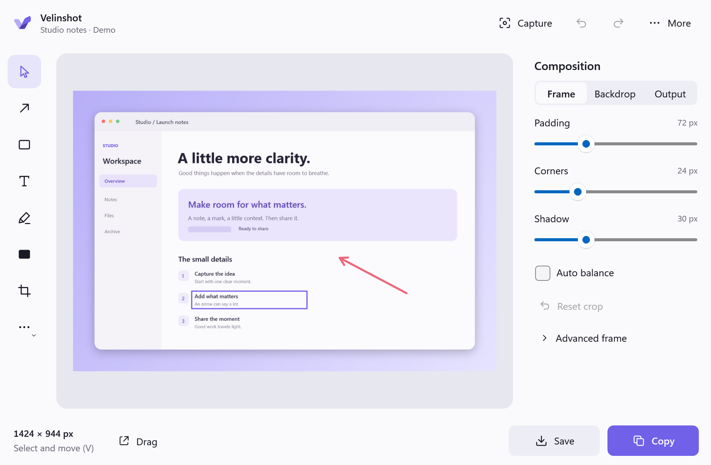
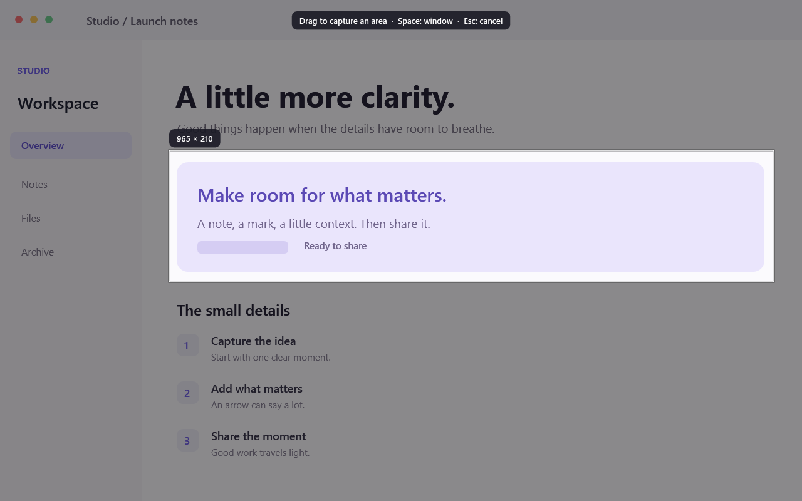

<div align="center">
  <p></p>
  <h1>Velinshot for Windows</h1>
  <p>Free, native screenshot editing for Windows 10 and 11.</p>
  <p><a href="#build-from-source"><strong>Build from source</strong></a> · <a href="docs/USAGE.md">User guide</a> · <a href="docs/QA.md">Validation</a></p>
</div>

<picture>
  <source media="(prefers-color-scheme: dark)" srcset="docs/images/editor-dark.png">
  
</picture>

<sub>The real WPF editor window, rendered with a synthetic screenshot.</sub>

**Ctrl+Shift+4 → capture → edit → C to copy or S to save.**

This is the Windows edition of Velinshot, alongside the [native macOS app](../README.md) in this repository. It keeps the same workflow, editor layout, frame engine and saved-file formats, rebuilt on Windows technologies: C#, .NET 10 and WPF with the Windows 11 Fluent theme.

- **Capture:** area, window and display, across every connected monitor, from a frozen snapshot so you get exactly what was on screen. Also open files, clipboard images and image drops.
- **Annotate:** arrows, boxes, pen, line, ellipse, text, numbered steps, highlight, blur and manual redaction, anywhere on the canvas including the mat outside the screenshot.
- **Frame:** automatic inset color, padding, rounded corners, shadows, gradient/solid/image/transparent backgrounds, desktop wallpaper, ratios, social sizes, exact output sizes and saved presets.
- **Export:** PNG or JPEG, one-key copy (keeps transparency for apps that read PNG), Save As, drag into any app or folder, and the Windows Share sheet.
- **Keep working:** local OCR with the Windows OCR engine, undo/redo, reopen the last closed screenshot, optional editable history.

No account, subscription, analytics, uploads or watermark. Screenshots stay on your PC unless you share them. History is off by default.



## Run it

Download the [Windows Setup EXE](https://github.com/Jacknelson6/Velinshot/releases/download/v1.0.0-preview.3/Velinshot-1.0.0-preview.3-win-x64-setup.exe). Requires Windows 10 version 2004 or later. Setup installs for your user under `%LOCALAPPDATA%\Programs\Velinshot`, with no .NET runtime installation or administrator request. Quit a running copy before installing; Setup will refuse to replace it while it is open.

The preview has **no Authenticode code-signing certificate**. Windows may show a SmartScreen warning. The updater's Ed25519 signatures authenticate the update feed and installer; they do not establish Microsoft publisher trust or remove first-launch warnings.

Velinshot stays in the notification area so shortcuts work after its windows close. Quit from that icon's menu. Settings, presets, backgrounds and optional history remain in `%APPDATA%\Velinshot`, separate from the installation. Updating or uninstalling the app leaves that data in place.

## Updates

Use **Check for Updates…** from the notification-area menu or the editor's More menu. The installed app verifies both the feed and installer before handing off to the standard installer, then relaunches. Save or copy your screenshots and close their editors first. Active capture, image imports and dialogs also defer installation.

**Settings → Check for updates automatically** is off by default. When enabled, NetSparkle checks daily and notifies you about available updates. It does not automatically download, install or restart. You choose when to continue.

Portable/source builds remain available for development. Portable or moved copies are not replaced in place; install with Setup to enable updates. The app verifies that its running folder matches its per-user installation record, including a custom Setup folder. A development build without clean release metadata and the real Windows public key explains that updates are unavailable. It never falls back to unsigned downloads. See [validation](docs/QA.md) for the observed test scope and remaining Windows checks.

Windows needs no screen-recording permission. Content an app protects from capture (some video players, DRM) appears black, as in every Windows screenshot tool.

## Build from source

Requires Windows 10 version 2004 or later, the [.NET 10 SDK](https://dotnet.microsoft.com/download/dotnet/10.0), and PowerShell 7 for the packaging/check scripts. The updater uses pinned NetSparkle 3.1.0; NuGet restores its locked dependencies. Inno Setup 6 creates the standard installer.

```powershell
git clone https://github.com/Jacknelson6/Velinshot.git
cd Velinshot\windows
pwsh -File scripts/check.ps1      # build + automated checks
dotnet run --project src/Velinshot
```

Release packaging requires a clean committed source tree and the Windows release public key in `updates/windows-ed25519.pub`. That file contains only the public key. The corresponding private key stays in the release owner's macOS Keychain, under the separate `com.jacknelson.velinshot.windows.ed25519` account. No private release key belongs in CI.

```powershell
pwsh -File scripts/package.ps1
```

This emits the Setup EXE, portable ZIP and immutable `BUILD-INFO.json` sidecar. `-Runtime win-arm64` selects Windows on Arm; only an architecture with a published, matching feed can update. `-FrameworkDependent -PortableOnly` produces a development portable build that requires the .NET 10 Desktop Runtime. Existing output directories are refused rather than overwritten.

The release owner signs the exact installer and complete appcast locally using the official Sparkle tools:

```sh
python3 windows/scripts/prepare-update.py --tools /path/to/Sparkle/bin \
  --metadata /path/to/Velinshot-1.0.0-preview.3-win-x64-BUILD-INFO.json \
  --output /path/to/new-signed-windows-feed
```

The script only looks up an existing Windows key, verifies source/build/artifact identity and prepares public signatures over unchanged installer and XML bytes. It does not generate a production key or publish a release. Publish the feed and adjacent `.signature` together on the repository's `updates` branch under `windows/`; installers remain immutable assets of their versioned release. The x64 feed is `appcast.xml`, and the ARM64 feed is `appcast-arm64.xml`; publishing one must preserve the other. `python3 windows/scripts/prepare-update.py --self-check` checks this routing without accessing a key.

Both Setup and the portable ZIP include official pinned package and bundled .NET runtime license files and notices under `ThirdPartyNotices`, with a hashed package manifest.

## How it maps to the Mac app

| macOS (Swift) | Windows (C#) |
|---|---|
| AppKit editor, `CanvasView`, inspector | WPF `EditorWindow`, `CanvasView`, same 60/64/250/64 layout |
| Core Graphics + Core Image renderer | `CanvasRenderer`: WPF media + Windows Imaging Component, with pixel passes for shadow, blur and multiply highlight |
| ScreenCaptureKit overlays per display | Frozen virtual-screen snapshot (GDI) with one overlay per display, physical pixels, per-monitor DPI v2 |
| Carbon global hot keys | `RegisterHotKey` |
| Vision OCR | `Windows.Media.Ocr` |
| `NSSharingServicePicker` | Windows Share sheet (`DataTransferManager`) |
| Menu-bar item and Dock | Notification-area icon and menu |
| `UserDefaults`, Application Support | `%APPDATA%\Velinshot\settings.json`, `%APPDATA%\Velinshot` |
| SMAppService launch at login | Per-user `Run` registry value |

Presets (`presets.json`), edit states and history metadata use the same JSON shapes as the macOS app, so they can move between the two.

Default shortcuts differ because ⌘4 has no safe Windows equivalent: Ctrl+4 would steal browser tab switching system-wide. Capture is **Ctrl+Shift+4**, capture-and-copy **Ctrl+Shift+5**, both configurable.

## Project layout

| Path | Contents |
|---|---|
| `src/Velinshot.Core` | The image engine: models, layout, renderer, auto balance and color, image I/O, history and presets, OCR |
| `src/Velinshot` | The app: editor, canvas, capture overlay, tray, hotkeys, settings, history, export |
| `tests/Velinshot.Checks` | Dependency-free engine checks (pixels, layout, JSON compatibility, storage, OCR, timings) |
| `scripts/` | `check.ps1`, `package.ps1`, `make-icon.ps1` (all run from this `windows` folder) |

The app also has developer modes used by `check.ps1`: `--interaction-check <folder>` drives the editor and capture selection off-screen, `--self-check <folder>` exercises the live platform (screen snapshot, hotkeys, OCR, share interop), and `--render-docs <folder>` renders every window in light and dark mode.

[MIT licensed](../LICENSE), like the macOS app.
